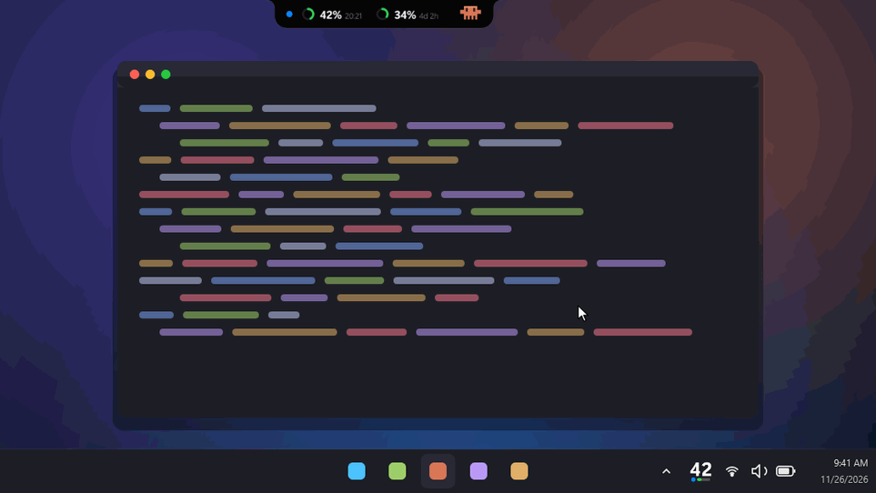
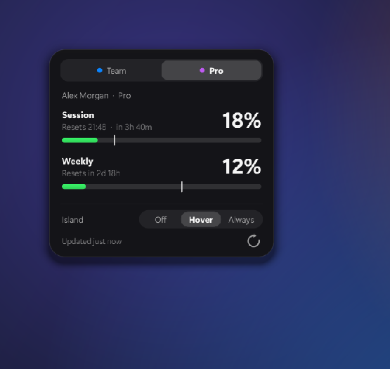
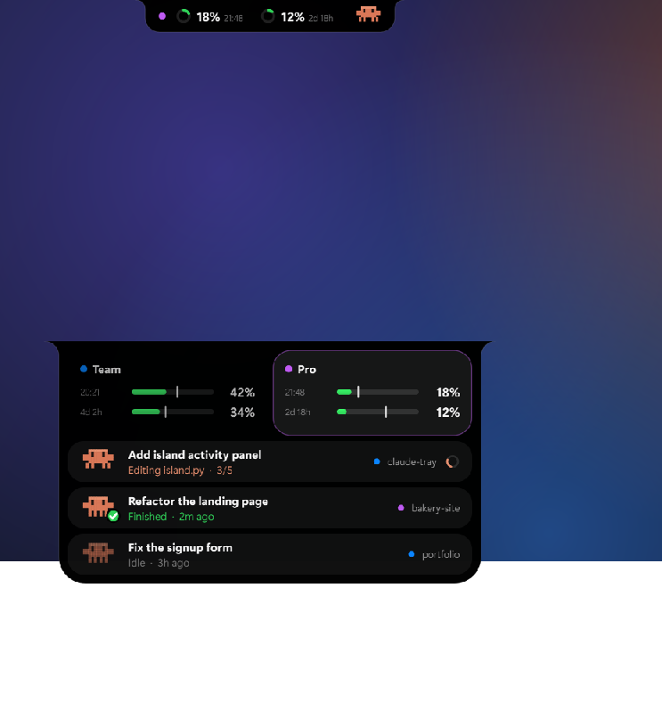
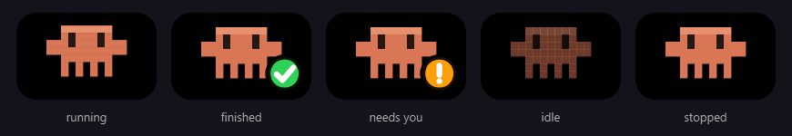

<h1 align="center">Claude Pulse</h1>

<p align="center">
  <b>Your Claude usage, one glance away.</b><br>
  A tiny, fast Windows tray monitor with a Dynamic Island for people who juggle more than one Claude account.
</p>

<p align="center">
  
</p>

<p align="center">
  
  
  
  
  
</p>

---

## Why

Claude's limits are two clocks: a **5-hour session** and a **weekly** allowance. Checking them means opening a page. Claude Pulse puts both numbers where your eyes already are, switches between your accounts with one click, and stays out of your way: it never blocks a window, never steals focus, and sits at about 3 MB of memory while idle.

It reads the same usage data as [Usage Monitor for Claude](https://github.com/jens-duttke/usage-monitor-for-claude) (MIT, by Jens Duttke), whose API approach this project builds on, and replaces the UI with something much lighter and more visual.

## What you get

### In the tray, next to Wi-Fi

The big number is your **session** usage, the bar underneath is your **weekly** usage, and the coloured dot says which account you are looking at. The number turns orange at 70% and red at 90%.

**Hover** the icon and a card slides up with both quotas, reset times and an account toggle. **Click** to pin it open. **Middle-click** switches account instantly.

<p align="center">
  
</p>

The thin white tick on each bar shows how much of that window has already passed. If the fill is ahead of the tick, you are burning quota faster than time is passing.

### A Dynamic Island at the top of the screen

A small pill grows out of the top edge like a notch, with curved ears where it meets the screen. It shows the **session** ring with the clock time it resets, the **week** ring with the days left, and a small Claude mascot.

<p align="center">
  
</p>

- **Click-through while collapsed**, so it can never block a title bar, tab or button underneath.
- **Rest the pointer on it** and it springs open to show both accounts side by side plus what your Claude sessions are doing. Click a panel to select that account.
- Gets a **red rim** when a quota is nearly gone and an **amber rim** when Claude is waiting for you. It hides itself during full-screen apps and games.

| Mode | Behaviour |
| --- | --- |
| **Always** | The pill stays on screen. |
| **Hover** | Hidden until you touch the top edge of the screen, in the middle. It drops down, and lifts away about a second after the pointer leaves. It also drops by itself for a few seconds when a task finishes or needs you. |
| **Off** | No island. |

Switch modes from the card (**Off | Hover | Always**) or the tray menu. A floating style with a soft shadow is available too: right-click > *Dynamic Island* > *Attached to the top edge*.

### See what Claude is doing

The mascot, and the rows under the accounts when the island is open, show what your **Claude Code** sessions are up to.

<p align="center">
  
</p>

| Mascot | Meaning |
| --- | --- |
| Bobbing, feet shuffling | A task is **running**; the row says what it is doing ("Editing island.py", the current to-do item) |
| Green check | The task **finished** |
| Amber `!` | Claude is **waiting for you** (a question or a plan to approve) |
| Dimmed | Idle, or the last task stopped |

Up to three recent sessions across both accounts are listed, running ones first, each tagged with its account colour.

## Install

Requires Windows 10/11 and Python 3.10 or newer.

```powershell
git clone https://github.com/albidnawar/claude-tray.git
cd claude-tray
pip install -r requirements.txt
pythonw run.pyw            # or double-click start-claude-pulse.bat
```

Want to look around before signing in? `python -m claude_pulse --demo --island`

### Put the icon next to Wi-Fi

Windows 11 hides new tray icons in the `^` flyout. Drag the icon out of it, or run once:

```powershell
powershell -ExecutionPolicy Bypass -File tools\pin-tray-icon.ps1
```

(`-Undo` reverses it.)

### Start with Windows

Right-click the tray icon and tick **Start with Windows**. It adds one per-user entry and launches silently at sign-in. Untick it to remove the entry.

## Your accounts

Claude Pulse finds accounts automatically and **never needs you to paste a token**. It reads the login Claude Code already created on your machine.

| Account | Where its login lives |
| --- | --- |
| First | `~/.claude` (or `CLAUDE_CONFIG_DIR`) |
| More | every folder in `~/.claude-profiles/` that has a `.credentials.json` |

To add another account, sign in once with its own config directory, then restart Claude Pulse:

```powershell
$env:CLAUDE_CONFIG_DIR = "$HOME\.claude-profiles\work"
claude auth login
```

Prefer explicit control? Create `%APPDATA%\ClaudePulse\settings.json`:

```json
{ "accounts": [
    { "id": "personal", "dir": "%USERPROFILE%\\.claude", "label": "Personal" },
    { "id": "work", "dir": "%USERPROFILE%\\.claude-profiles\\work", "label": "Work" }
] }
```

Tab labels default to the plan name (Team, Pro, Max 5x...) when the plans differ, otherwise your first name.

## Fast and light

- One pointer poll every 50 ms (a cursor read and a rectangle test) and nothing else while idle: about 0 to 1% of one core.
- **Memory:** about 34 MB committed, and Task Manager shows roughly 3 MB while it sits idle. Resident pages are handed back to Windows after 20 quiet seconds and faulted back in on demand. Only PySide6 is needed: HTTP and TLS are the Python standard library.
- Usage refreshes every 90 s while the card or island is visible and every 4 min otherwise, and again the moment you hover if the data is over 45 s old. Rate limits (429) and errors back off automatically.
- Numbers glide to new values instead of jumping. The mascot only animates while a task is running and the island is on screen.

## Privacy and what it touches

This repository contains **no credentials**, and the app never stores or transmits them anywhere except to Anthropic.

- **Network:** only `api.anthropic.com`, the same usage and profile endpoints Claude Code itself uses. Your OAuth token is read from each account's `.credentials.json` and used only in the request header. Certificates are verified (hostname included) against the Windows certificate store, so a company proxy's root certificate works, and Windows proxy settings apply.
- **Token renewal:** if a token has expired, it runs `claude update` for that account (as Usage Monitor for Claude does), which makes the CLI renew the login.
- **Your Claude transcripts (read-only, local):** to show what a session is doing, it reads the **last part** of the newest `projects\*\*.jsonl` files in each account's Claude folder every 2 seconds, and only while the island is on screen. It takes the session title, project folder name, the current tool call and whether the turn has finished. Nothing is stored, logged or sent anywhere. Because titles and project names appear on the island, switch off *Show Claude activity* before sharing your screen.
- **Files:** `%APPDATA%\ClaudePulse\settings.json` (selected account, island mode, activity on/off). A lock file in the temp folder prevents two copies.
- **Registry:** only if you enable *Start with Windows* (one `HKCU\...\Run` value) or run `pin-tray-icon.ps1`.

## Troubleshooting

| Symptom | Fix |
| --- | --- |
| "Sign-in expired" / "Not signed in" | Run `claude auth login` (with `CLAUDE_CONFIG_DIR` set for that account) |
| Hover does nothing | The icon is in the `^` flyout; pin it (see above) |
| "Offline" in the card footer | No connection or rate-limited; the last values stay visible and it retries on its own |
| Nothing at the top of the screen | The island is *Off* or in *Hover* mode. Choose *Always* in the card, or touch the top edge of the screen in the middle |
| The mascot never shows a task | Only Claude Code sessions are tracked (terminal and IDE), not claude.ai chats. Check *Show Claude activity* is ticked |
| A session shows "Idle" during a very long command | A transcript that has not changed for 10 minutes counts as idle |

## Development

```powershell
python -m unittest discover -s tests                  # logic and UI tests
python tools\preview.py preview                       # renders icon, card and island states to PNGs
python tools\make_readme_media.py assets              # regenerates the images and GIFs in this README
python -m claude_pulse --debug                        # prints where Windows places the tray icon
```

The pictures in this README are rendered from the real widgets with demo data, so no real account appears in them.

| Module | Role |
| --- | --- |
| `usage_api.py` | the only code that touches credentials and the network |
| `quotas.py`, `formatting.py` | pure parsing and text, unit tested |
| `store.py` | polling, backoff, per-account state |
| `activity.py` | reads transcript tails and decides running / finished / needs you |
| `mascot.py` | the pixel-art mascot and its animation |
| `card.py`, `island.py`, `tray_icon.py` | the three surfaces, drawn with QPainter |
| `winapi.py` | the only OS-specific code (click-through, fullscreen, autostart, memory trim) |

## Credits and license

MIT. See [LICENSE](LICENSE). The usage-API approach comes from [Usage Monitor for Claude](https://github.com/jens-duttke/usage-monitor-for-claude) by Jens Duttke. Claude Pulse is an independent project and is not affiliated with or endorsed by Anthropic; "Claude" is a trademark of Anthropic.
